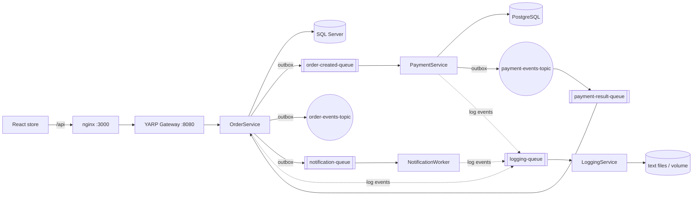

# Architecture

## Key decisions
* **Database per service.** SQL Server (orders), PostgreSQL (payments), text files (logging). No cross-DB access; services only share *message contracts* (`BuildingBlocks.Contracts`).
* **Choreographed Saga.** `OrderCreated` → PaymentService charges → `PaymentSucceeded/Failed` → OrderService confirms the order or marks `PaymentFailed` and releases the reserved stock. Cancellation releases stock too. There is no synchronous HTTP between services.
* **Transactional Outbox** (Order + Payment): events are written to an `OutboxMessages` table in the *same* transaction as the business change; a background `OutboxDispatcher` publishes them to SQS/SNS and marks them sent (at-least-once).
* **Inbox / idempotency.** Consumers record processed `EventId`s (`InboxMessages`) and handlers are themselves idempotent. PaymentService additionally has a unique `IdempotencyKey` (`order-{orderId}`) so duplicate SQS deliveries never charge twice.
* **Retries + DLQ.** The consumer deletes a message only after success; on failure it extends the visibility timeout exponentially (2^n·2 s, capped); the queue redrive policy moves it to `<queue>-dlq` after `MaxReceiveCount` (5).
* **SNS→SQS with raw delivery** for payment events (broadcast capable); `OrderCreated` goes to the SQS queue directly and is also broadcast on `order-events-topic`.
* **Logging is asynchronous.** `IBusinessLogger` enqueues into a bounded in-memory channel and a background loop sends to `logging-queue`; failures are swallowed (never break business flow). LoggingService can be down without affecting purchases. Card numbers/CVV/secrets are redacted client-side and again server-side.
* **Stock reservation** happens at order creation (optimistic concurrency via `RowVersion`), released on cancel / payment failure.
* **Gateway** exposes only `/api/products` and `/api/orders`; payment endpoints are internal (also protected by `X-Internal-Api-Key`).
* **Tracing.** `X-Correlation-Id` is created at the gateway, flows through HTTP headers into every message envelope (`CorrelationId`) and into log files. OpenTelemetry tracing is wired (set `OTEL_CONSOLE=true` for console output; swap exporter for OTLP/X-Ray).
* **Message envelope:** `EventId, EventType, CorrelationId, OccurredAt, EventVersion, Payload`.

## Queues / topics
| Name | Producer | Consumer |
|---|---|---|
| order-created-queue (+dlq) | OrderService | PaymentService |
| payment-result-queue (+dlq) | SNS payment-events-topic | OrderService |
| notification-queue (+dlq) | OrderService | NotificationWorker |
| logging-queue (+dlq) | all services | LoggingService |
| order-events-topic | OrderService | (broadcast, no subscribers yet) |
| payment-events-topic | PaymentService | payment-result-queue |

## CQRS
Commands/queries are MediatR requests in each `*.Application` project; a `ValidationBehavior` runs FluentValidation validators before handlers. Controllers only call `ISender`. DTOs are used at every API boundary.

## Notification architecture
OrderService writes `CustomerNotificationEvent` (order confirmation, payment success/failure, cancellation) to the outbox → `notification-queue`. NotificationWorker dispatches to `INotificationProvider`; `MockNotificationProvider` logs to console + `notifications.txt`. Add `EmailNotificationProvider` (SES) / `SmsNotificationProvider` (SNS) by implementing the interface.
